<p align="center">
  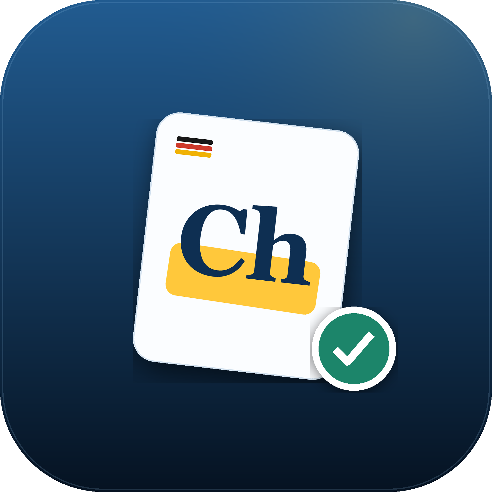
</p>

<h1 align="center">دفتر الشانكس — Deutsch Chunk Trainer</h1>

<p align="center">
  مدرب ألماني أوفلاين: 1500 جملة من A1 لـ C1، كل جملة بمسار 6 خطوات، وحفظ تلقائي لنقطة توقفك.
</p>

<p align="center">
  
  
  
  
  
</p>

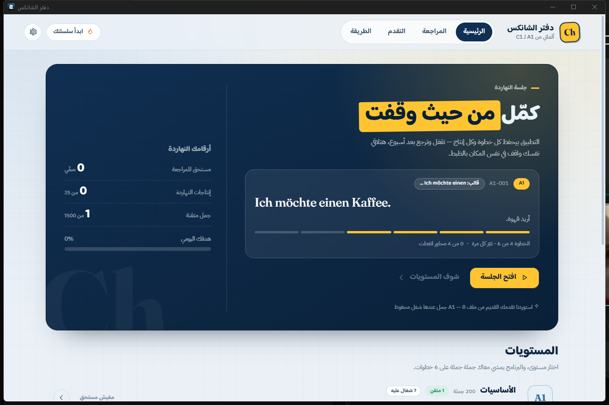

## الفكرة

معظم متعلمي الألماني بيحفظوا كلمات مفردة، وبعدين يوقفوا لما يحاولوا يكوّنوا جملة. التطبيق ده بيشتغل على **الـChunk**: جملة كاملة أو قالب جاهز بيتكرر ويتغيّر لحد ما يطلع منك تلقائي في الكلام.

المحتوى مبني على ملفاتي الشخصية لتعلم الألمانية (A1–C1)، والدليل البصري «إتقان الشانكس خطوة بخطوة». كل جملة عدّت على 6 مراحل، وكل مرحلة ليها شرط واضح.

- **1500 جملة** موزعة: A1 (200)، A2 (250)، B1 (300)، B2 (400)، C1 (350).
- **قوالب**: الجمل اللي بتشترك في نفس البداية بتتجمع كقالب واحد، فبتشوف الجزء الثابت والجزء اللي بيتغيّر.
- **حفظ تلقائي**: كل ضغطة، كل إنتاج، كل تنويع، وكل نتيجة اختبار بتتحفظ فورًا في ملف محلي.
- **أوفلاين بالكامل**: مفيش سيرفر، مفيش حساب، ومفيش أي بيانات بتطلع من الجهاز.

## المميزات

- واجهة عربية RTL كاملة مع جمل ألمانية LTR مدمجة، وخطوط محلية (Baloo Bhaijaan 2 + IBM Plex Sans Arabic + Fraunces).
- 5 مستويات مع نسبة الإتقان، عدد المستحق، والجمل اللي شغال عليها.
- فلترة وبحث داخل كل مستوى (بالألماني أو العربي أو كود الجملة).
- جلسة جملة بست مراحل، مع شريط مسار بيوضّح إنت فين.
- صوت ألماني (Windows TTS) بسرعتين، واختبار «من غير ما تبص»، وتسجيل صوتي اختياري للمقارنة.
- جدول إنتاج 10 + 5 + 5 + 5 + 5 بمواعيده، ومراجعة متباعدة تلقائية.
- 5 اختبارات: استدعاء سريع، تنويع، سباق 60 ثانية، كلام مرتجل 30–45 ثانية، واستدعاء مؤجل بعد أسبوع.
- مراجعة يومية بتجمع المستحق فقط، مع تقييم بيحدد ميعاد الرجوع.
- إحصائيات: إنتاجات، جمل متقنة، وقت تدريب، سلسلة أيام، وخريطة نشاط 12 أسبوع.
- تصدير/استيراد التقدم كملف JSON، ونسخ احتياطية تلقائية.
- وضع ليلي، وهدف يومي، واختيار صوت النطق.

## لقطات من التطبيق

### الرئيسية — كمّل من حيث وقفت

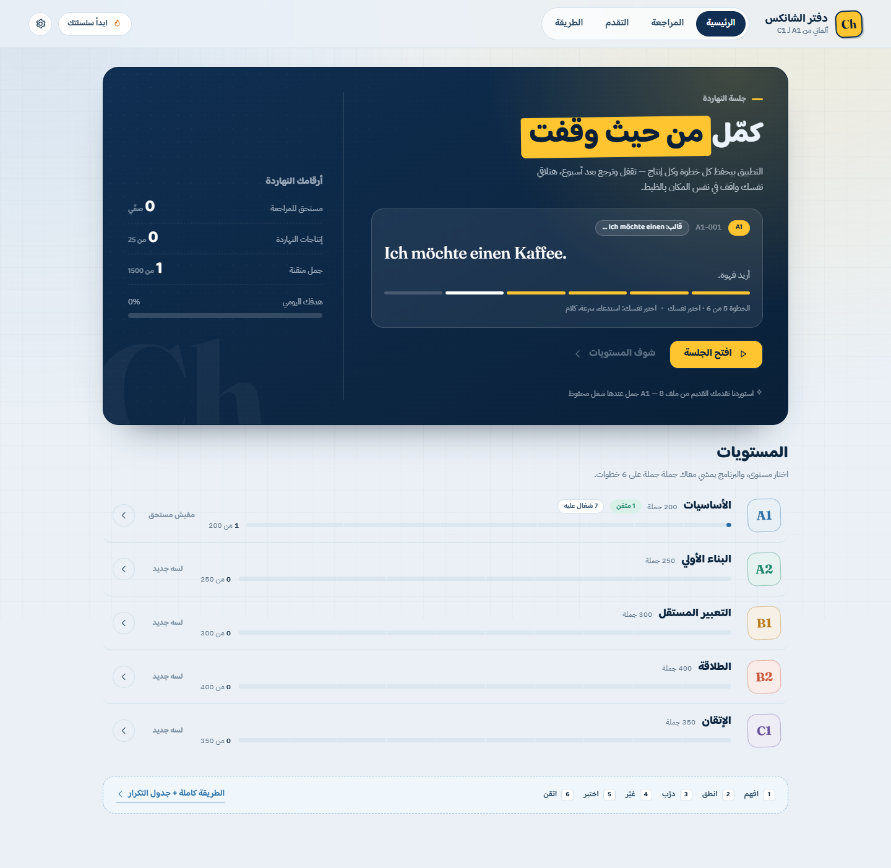

### المستوى — كل الجمل وقوالبها

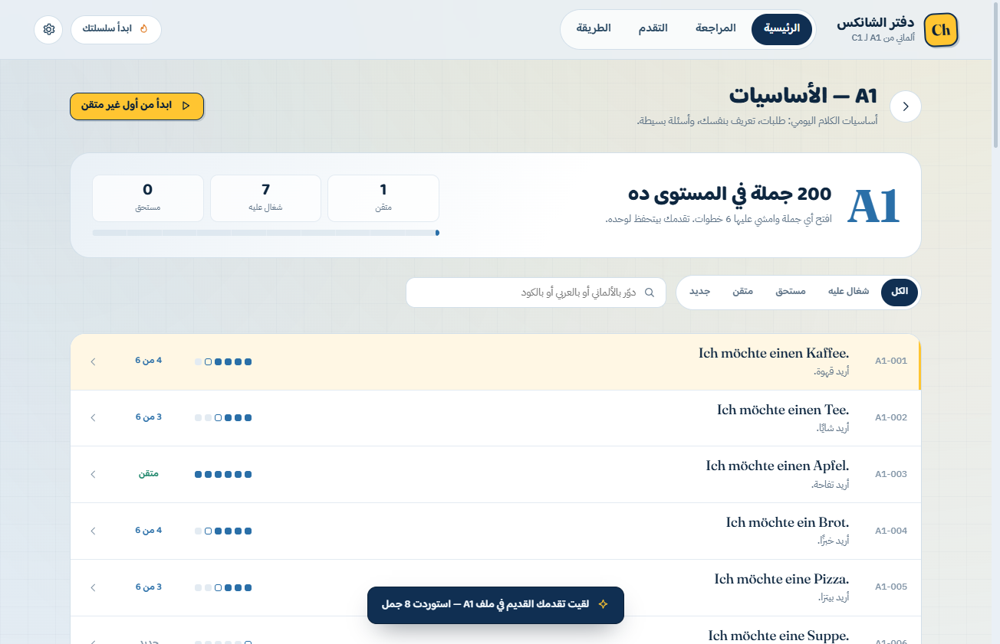

### جلسة الجملة — ست مراحل

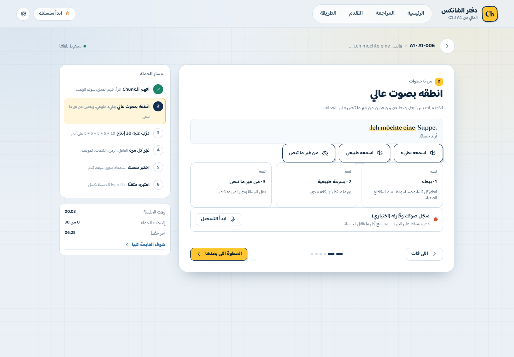

### المراجعة اليومية

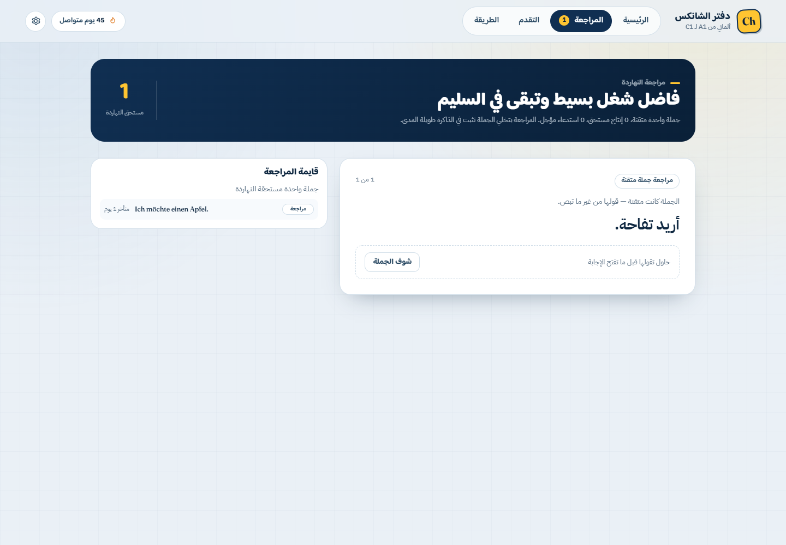

### التقدم

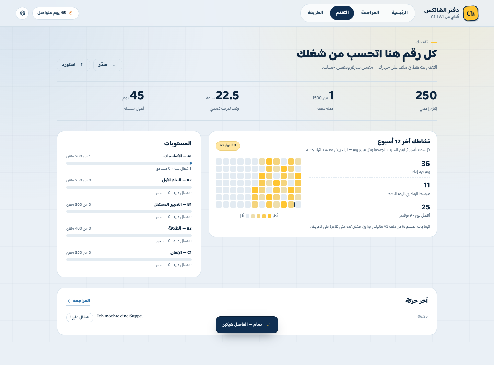

### الإعدادات

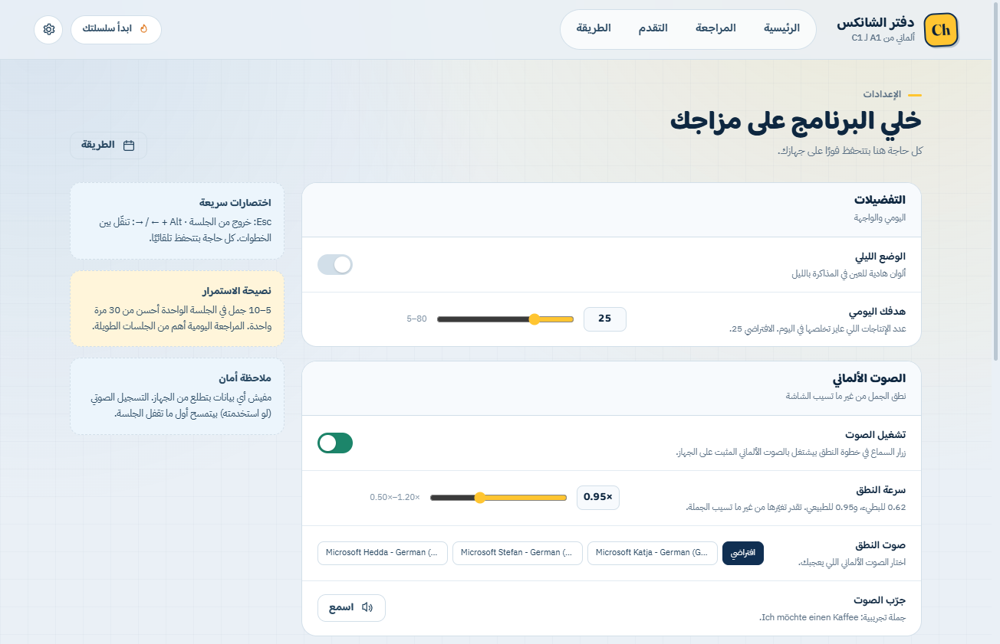

### الدليل والطريقة

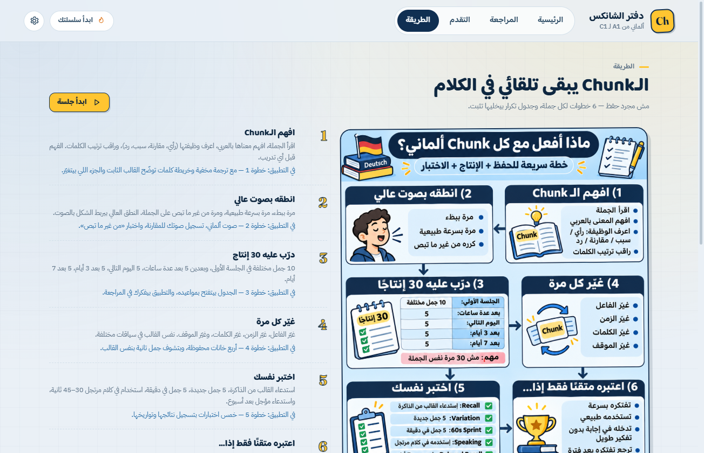

### الوضع الليلي

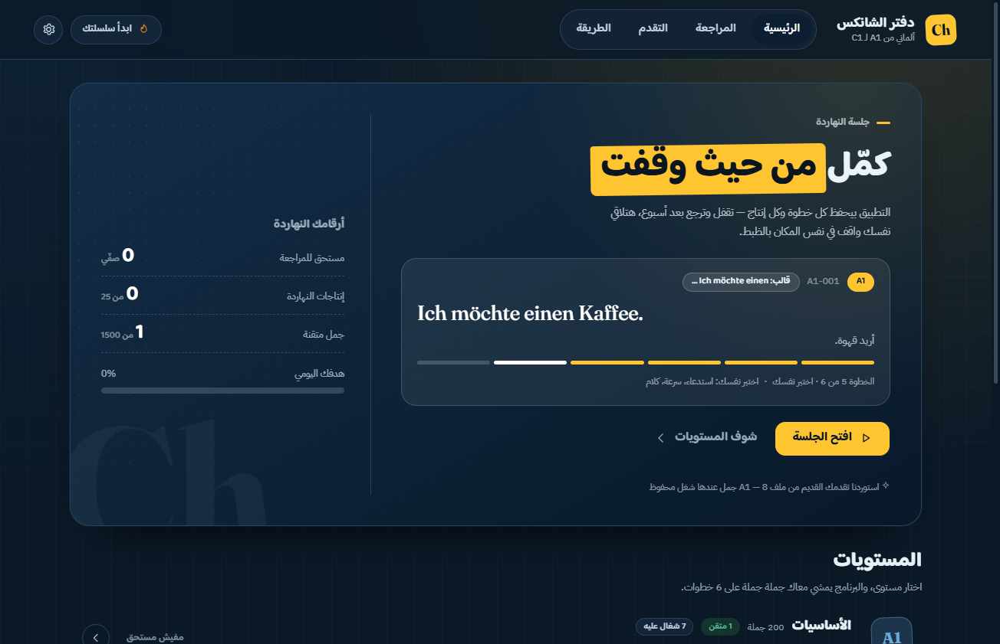

### على شاشة صغيرة

<p align="center">
  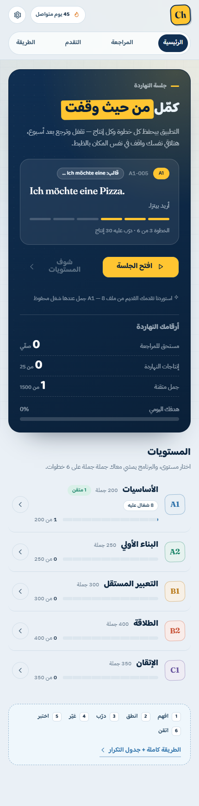
</p>

## طريقة التعلم داخل التطبيق

| # | المرحلة | إيه اللي بيحصل |
|---|---------|----------------|
| 1 | افهم الـChunk | الجملة كبيرة، الترجمة مخفية لحد ما تضغط، خريطة كلمات توضّح القالب الثابت والجزء المتغيّر، وتحديد وظيفة الجملة (رأي/مقارنة/سبب/رد…) |
| 2 | انطقه بصوت عالي | سماع ببطء وبسرعة طبيعية، اختبار «من غير ما تبص» بعدّاد، وتسجيل صوتك للمقارنة (اختياري ومش بيتحفظ) |
| 3 | درّب عليه 30 إنتاج | جدول 10 + 5 + 5 + 5 + 5 بمواعيده. مش 30 مرة نفس الجملة — 30 جملة مختلفة بنفس القالب |
| 4 | غيّر كل مرة | الفاعل، الزمن، الكلمات، والموقف. التنويعات بتتحفظ، وبتشوف جمل تانية بنفس القالب |
| 5 | اختبر نفسك | استدعاء سريع (4 من 5)، تنويع (5 جمل)، سباق 60 ثانية (5 جمل)، كلام مرتجل (30 ثانية+)، واستدعاء مؤجل بعد 7 أيام |
| 6 | اعتبره متقنًا | الشروط الخمسة لازم تكتمل. بعد الإتقان الجملة بتدخل جدول مراجعة: 3 أيام، وبعدها الفاصل بيطول تلقائيًا |

### جدول الـ30 إنتاج

| المرحلة | عدد الجمل | إمتى |
|---------|-----------|------|
| الجلسة الأولى | 10 جمل مختلفة | أول ما تتعلم الجملة |
| بعد عدة ساعات | 5 | نفس اليوم |
| اليوم التالي | 5 | بعد 24 ساعة |
| بعد 3 أيام | 5 | مراجعة |
| بعد 7 أيام | 5 | مراجعة نهائية |

> المواعيد جزء من الطريقة، مش عطل. عشان كده ممكن جملة تفضل «شغال عليها» أسبوع قبل الإتقان.

## كيف بيتحفظ التقدم؟

- الملف: `%APPDATA%\ChunkTrainer\progress.json` — بيتحفظ بعد كل خطوة بكتابة آمنة (ملف مؤقت ثم استبدال).
- نسخ احتياطية تلقائية في `%APPDATA%\ChunkTrainer\backups` (آخر 12 نسخة).
- أول تشغيل: التطبيق بيقرأ علامات ✓ اللي في ملف A1 القديم ويستوردها، وبيكمل من أول جملة ناقصة.
- تصدير/استيراد من صفحة الإعدادات (JSON).
- مفيش أي اتصال شبكي أثناء التشغيل؛ الخطوط والأيقونات والصور كلها محلية.

## التشغيل

### المتطلبات

- Windows 10/11 (التطبيق موجّه لسطح المكتب).
- Node.js 20 أو أحدث.
- مساحة حوالي 400 ميجا بعد تثبيت Electron.

### من المصدر

```powershell
git clone https://github.com/abdoabdo22334456-prog/deutsch-chunk-trainer.git
cd deutsch-chunk-trainer
npm install
npm start
```

أو على ويندوز: دوس دوبل كليك على `start.cmd`.

> **مهم:** بعض النسخ من Electron بتقفل فورًا لو المشروع جوه فولدر OneDrive. انسخ المشروع لفولدر محلي (مثل `C:\ChunkTrainer`) قبل `npm install`.
>
> لو `npm install` خلّص من غير ما ينزّل Electron، شغّل `node node_modules/electron/install.js` مرة واحدة.

### نسخة Windows الجاهزة

من [صفحة الإصدارات](https://github.com/abdoabdo22334456-prog/deutsch-chunk-trainer/releases) حمّل ملف `ChunkTrainer-Setup-...exe` للتثبيت أو `ChunkTrainer-Portable-...exe` للتشغيل بدون تثبيت. النسختان تحتويان Electron والملفات اللازمة؛ لا تحتاج تثبيت Node.js أو متصفح منفصل. بيانات التقدم محفوظة خارج ملفات البرنامج، وتظل موجودة عند تحديث التطبيق.

### بناء نسخة Windows من المصدر

```powershell
npm ci
npm run build:win
```

ستجد ملف التثبيت والنسخة المحمولة داخل `dist/`. هذا البناء لا ينشر الإصدار تلقائيًا على GitHub.

## اختصارات

- `Esc` خروج من جلسة الجملة.
- `Alt + →` / `Alt + ←` المرحلة اللي بعدها / اللي فاتت.
- `F5` أو `Ctrl + R` إعادة تحميل.

## بنية المشروع

```
chunk-trainer/
├─ electron/
│  ├─ main.cjs              نافذة Electron + حفظ الحالة + التصدير/الاستيراد + النسخ الاحتياطي
│  └─ preload.cjs           جسر آمن عبر contextBridge
├─ src/
│  ├─ index.html            الهيكل + الأيقونات + CSP
│  ├─ styles/               التصميم (tokens، شاشات، خطوط محلية)
│  └─ js/
│     ├─ app.js             الراوتر والهيدر
│     ├─ store.js           الحالة، الجدولة، الاستيراد، الحفظ
│     ├─ drills.js          تمارين الاستدعاء/السرعة/الكلام
│     ├─ ui.js, utils.js    مكونات مشتركة وأدوات
│     └─ screens/           الرئيسية، المستوى، الجلسة، المراجعة، التقدم، الإعدادات، الدليل
├─ data/chunks.json         1500 جملة (ألماني + عربي + علامات التقدم القديمة)
├─ scripts/
│  ├─ parse-chunks.mjs      استخراج المحتوى من ملفات Markdown
│  ├─ fetch-fonts.mjs       تنزيل الخطوط مرة واحدة (اختياري)
│  ├─ preview.mjs           سيرفر معاينة للمتصفح
│  └─ visual-test.mjs       اختبار واجهة آلي + سكرين شوت
├─ assets/                  الخطوط، icon.ico / icon.png، صورة الدليل
├─ docs/screenshots/        صور الشاشات
├─ start.cmd
└─ package.json
```

## كيف اتولدت البيانات؟

الملفات الأصلية كانت بصيغة Obsidian:

```markdown
### A1-001 — Ich möchte einen Kaffee.

أريد قهوة.

- [x] 10 + 5 + 5 + 5 + 5 إنتاجات متنوعة
- [x] الاستدعاء
- [ ] 5 جمل جديدة
...
```

`scripts/parse-chunks.mjs` بيقرأ الملفات الخمسة، ويستخرج:

- كود الجملة، الجملة الألمانية، والترجمة العربية.
- ست علامات ✓ لكل جملة (اللي بتتحول لتقدم مستورد).
- القوالب: الجمل اللي بتشترك في أول 3 كلمات بتتجمع في عائلة واحدة.

لتحديث المحتوى:

```powershell
$env:CHUNKS_DIR="C:\path\to\markdown-folder"
npm run parse
```

## التقنيات

- **Electron 45** مع `contextIsolation` و`sandbox` وCSP صارمة.
- **Vanilla JS** بدون framework أو build step — الراوتر والحالة مكتوبين بـ ES Modules.
- **CSS** بتصميم RTL وإحساس «دفتر تدريب»: ورق فاتح، حبر كحلي، وهايلايتر أصفر.
- **خطوط محلية**: Baloo Bhaijaan 2 (عناوين)، IBM Plex Sans Arabic (نصوص)، Fraunces (جمل ألمانية).
- **تخزين محلي**: JSON + نسخ احتياطية، بدون قاعدة بيانات أو سيرفر.

## قيود معروفة

- الصوت بيعتمد على أصوات ويندوز. لو مفيش صوت ألماني، ثبّت Deutsch من إعدادات ويندوز.
- التسجيل الصوتي اختياري وبيتمسح أول ما تقفل الجلسة.
- الواجهة عربية فقط (RTL) — الإنجليزية مش مضافة.
- شرط الـ7 أيام للإنتاج والاستدعاء المؤجل مقصود، وبيأخر «الإتقان» أسبوع.
- التطبيق موجّه لـ Windows. الـrenderer نفسه بيشتغل في أي Chromium، لكن تجربة سطح المكتب مصممة لويندوز.
- مفيش مزامنة سحابية؛ النقل بين الأجهزة عن طريق تصدير/استيراد JSON.

## المساهمة

المشروع شخصي لكن المساهمات والاقتراحات مرحّب بيها:

1. افتح Issue لو لقيت مشكلة أو عندك فكرة.
2. لو هتضيف محتوى جديد، عدّل ملفات Markdown ثم شغّل `npm run parse`.
3. اختبر الواجهة: `npm run preview` ثم `npm run test:ui`.

## الترخيص

الكود متاح تحت [MIT](LICENSE). المحتوى التعليمي (الجمل والترجمات) ملكي الشخصي ومخصص للاستخدام الشخصي في التعلم.

---

<p align="center">
  اتبنى بـ ☕ و<bdi>Chunks</bdi> — بالتوفيق في الألماني 🇩🇪
</p>
